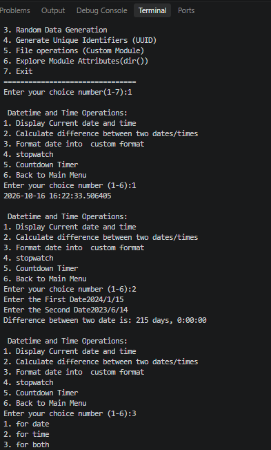

# 🧰🐍 Moduler-Packager 🚀✨

🎯 A menu-driven Python application that brings together useful utilities in separate modules and a package. Explore date and time operations, mathematical calculations, random data generation, UUIDs, file handling, and Python modules! 💻⚡

## 🚀🌟 Features

### 🕒📅 1. Date and Time Operations
- 📆 Display the current date and time.
- ⏳ Calculate the difference between two dates.
- 🗓️ Format date and time.
- ⏱️ Use a stopwatch and countdown timer.

### 🧮📐 2. Mathematical Operations
- 🔢 Perform mathematical calculations.
- 💰 Calculate compound interest.
- 📊 Calculate trigonometric values such as sine and cosine.
- 🔵 Calculate the area of a circle.
- ▭ Calculate the area of a rectangle.
- ◻️ Calculate the area of a square.

### 🎲🎯 3. Random Data Generation
- 🔢 Generate random numbers and lists.
- 🔐 Create random passwords.
- 📲 Generate random OTPs.

### 🆔🔑 4. UUID Generation
- 🧬 Generate unique identifiers (UUIDs).

### 📁📂 5. File Operations
- 🛠️ Perform file-related operations through a custom module.
- 🆕 Create files.
- ✍️ Write and append text.
- 📖 Read file contents.

### 🔍📚 6. Module Exploration
- 🧭 Explore module attributes using Python's `dir()` function.
- 🐍 Learn more about Python modules and their available attributes.

## 🛠️💻 Technologies Used

- 🐍 Python
- 📦 Python Standard Library
- 🖥️ Visual Studio Code
- 🌿 Git
- 🐙 GitHub

## 📚🧠 Concepts Used

- 🧩 Functions
- 🔀 Conditional statements (`if`, `elif`, `else`)
- 🔁 Loops (`for`, `while`)
- ⌨️ User input and output
- 📦 Modules and packages
- 📥 Importing libraries
- 🛡️ Exception handling (where implemented)
- 🕒 Date and time handling
- 🎲 Random number generation
- 📂 File handling
- ✨ String formatting
- ➗ Mathematical formulas

## 🧭🎮 How to Use

1. ▶️ Run the program from the terminal.
2. 📋 Choose an option from the main menu.
3. ⌨️ Enter the requested values.
4. ✅ View the result displayed in the terminal.
5. 🔙 Return to the main menu to perform another operation.
6. 🚪 Select the exit option when finished.

## ⚙️📥 Installation and Setup

1. 🐍 Install a compatible version of Python.
2. 📥 Download or clone the project repository.
3. 💻 Open the project folder in Visual Studio Code or a terminal.
4. 📂 Navigate to the project root directory.
5. ▶️ Run the application:

```bash
python main.py
```

🪟 On Windows, you can also run:

```bash
py main.py
```

📌 **Requirements:** Python and its standard library. Third-party packages are not required if the project uses only standard library modules.

## 💻🖥️ Example Output

### 🏠📋 Main Menu

```text
🎉 Welcome to Multi-Utility Toolkit 🎉
=====================================

Choose an option:
1. 🕒 Date-Time and Time Operation
2. 🧮 Mathematical Operation
3. 🎲 Random Data Generation
4. 🆔 Generate Unique Identifiers (UUID)
5. 📁 File Operation (Custom Module)
6. 🔍 Explore Module Attributes (dir())
7. 🚪 Exit

Enter Your Choice :- 2
```

### 🔵📐 Example: Area of a Circle

```text
Select an Option:
1. 🔵 Area of Circle
2. ▭ Area of Rectangle
3. ◻️ Area of Square
4. 🔙 Back to Main Menu

Enter Choice: 1
Enter radius: 30
Area of Circle = 2827.43
```

📌 *Note: The example output is illustrative. Actual menu wording depends on your program.*

## 📸🖼️ Output Screenshots

📷 Save your application screenshots in the project root directory or in a folder named `screenshots`.

For a screenshot named `output.png` in the project root:




For multiple screenshots:

```markdown
### 🏠 Main Menu


### 🧮 Mathematical Operations


### 🎲 Random Data Generation


### 📁 File Operations

```

⚠️ Make sure the image filenames and paths match the actual files in your repository.

## 📂🗂️ Project Structure

```text
Moduler-Packager/
├── 📦 package/
│   ├── __init__.py
│   ├── explore_utils_module.py
│   ├── file_utils.py
│   └── math_utils.py
├── 🐍 main.py
├── 📄 rr.txt
├── 🖼️ output.png
└── 📘 README.md
```

## 🎯🏆 Learning Outcomes

- 🧩 Understand Python modules and packages.
- 💻 Build menu-driven applications.
- 📚 Use Python's standard library.
- 🕒 Perform date and time calculations.
- 🧮 Apply mathematical formulas.
- 🎲 Generate random data and UUIDs.
- 📂 Perform file operations.
- 🔍 Explore modules using `dir()`.
- 🌿 Manage projects using Git and GitHub.

## 🔮🚀 Future Improvements

- ✅ Add stronger input validation.
- 🛡️ Improve exception handling.
- ➕ Add more utility functions.
- 🎨 Improve the user interface.
- 🧪 Add automated tests.

## 👨‍💻✨ Author

**Vishal Parmar** 🚀

⭐ If you find this project useful, consider giving the repository a star on GitHub! 🌟
